# What is this project?

This document explains everything in the AI Library Assistant: what it does, how each file works, and how the pieces connect. For setup and run commands, see [README.md](README.md).

> **Viewing the diagrams.** The diagrams are written in Mermaid. They render automatically on GitHub. In PyCharm, enable them under Settings → Languages & Frameworks → Markdown → Markdown Extensions → Mermaid, then open this file's preview. In VS Code, install the "Markdown Preview Mermaid Support" extension.

## Contents

1. [The idea in one paragraph](#1-the-idea-in-one-paragraph)
2. [The big picture](#2-the-big-picture)
3. [Every file and its job](#3-every-file-and-its-job)
4. [The data](#4-the-data)
5. [The two tools](#5-the-two-tools)
6. [The agent loop](#6-the-agent-loop)
7. [The terminal version](#7-the-terminal-version)
8. [The web version](#8-the-web-version)
9. [Reservations and human approval](#9-reservations-and-human-approval)
10. [The API reference](#10-the-api-reference)
11. [The React frontend](#11-the-react-frontend)
12. [Choosing the AI model](#12-choosing-the-ai-model)
13. [Error handling](#13-error-handling)
14. [Safety decisions](#14-safety-decisions)
15. [Testing](#15-testing)
16. [Glossary](#16-glossary)
17. [Ideas for extending it](#17-ideas-for-extending-it)

---

## 1. The idea in one paragraph

An AI model is good at understanding what someone wants ("Reserve Python Crash Course for Ahmed") but cannot touch your files. Python can read and write files but cannot understand English. This project combines them. The model reads the request and decides which Python function (a **tool**) should run, with which arguments. Python runs the function, gives the result back to the model, and the model turns that result into a friendly answer. This pattern is called **tool calling** (or function calling), and a program that loops through it is called an **agent**.

The model never runs code itself. It only *asks* for a tool. Python decides whether and how to run it.

---

## 2. The big picture

The same tools and agent logic are used by two front doors: a terminal chat and a web chat.

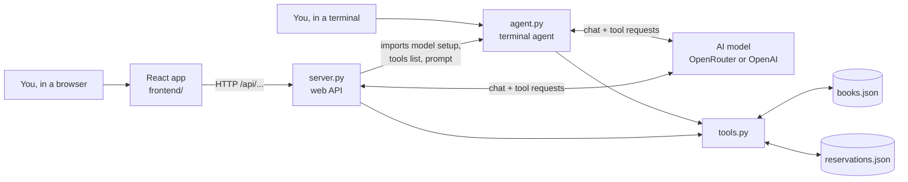

| Layer | Files | Job |
|---|---|---|
| Interface | `agent.py` (terminal) or `frontend/` (web) | Where you type and read answers |
| API | `server.py` | Lets the web page reach the agent |
| Brain | AI model (remote) | Understands requests, chooses tools, writes answers |
| Hands | `tools.py` | Does the real work on the data |
| Memory | `books.json`, `reservations.json` | Stores the catalogue and reservations |

---

## 3. Every file and its job

### Python side

| File | What it contains | Used by |
|---|---|---|
| `tools.py` | `search_books()`, `check_reservation()`, `reserve_book()` and small helpers to load and save JSON | `agent.py`, `server.py`, `test_tools.py` |
| `agent.py` | API client setup, the `TOOLS` descriptions, `SYSTEM_PROMPT`, `run_tool()`, the terminal agent loop | You (terminal) and `server.py` (imports from it) |
| `server.py` | FastAPI app with `/api/chat`, `/api/confirm`, `/api/health`; per-tab sessions; the pausable agent loop | The React app |
| `test_tools.py` | 8 offline tests, run on temporary copies of the data | You, to check the tools |
| `books.json` | The catalogue | `tools.py` |
| `reservations.json` | Saved reservations | `tools.py` |
| `requirements.txt` | `openai`, `python-dotenv`, `fastapi`, `uvicorn` | `pip install` |
| `.env` | Your API key and optional model name | `agent.py` (through `python-dotenv`) |

### Web side (`frontend/`)

| File | What it contains |
|---|---|
| `index.html` | The empty page with `<div id="root">` that React fills |
| `src/main.jsx` | Starts React and loads the styles |
| `src/App.jsx` | The chat screen: message list, input box, sending, Confirm/Cancel handling |
| `src/components/Message.jsx` | Draws one message: user bubble, bot reply, buttons, "Tool used" caption |
| `src/api.js` | The only code that calls the Python API |
| `src/styles.css` | Colors, layout and the phone layout |
| `vite.config.js` | Dev server settings; forwards `/api` to Python |
| `package.json` / `package-lock.json` | JavaScript packages and their exact versions |

### How the files depend on each other

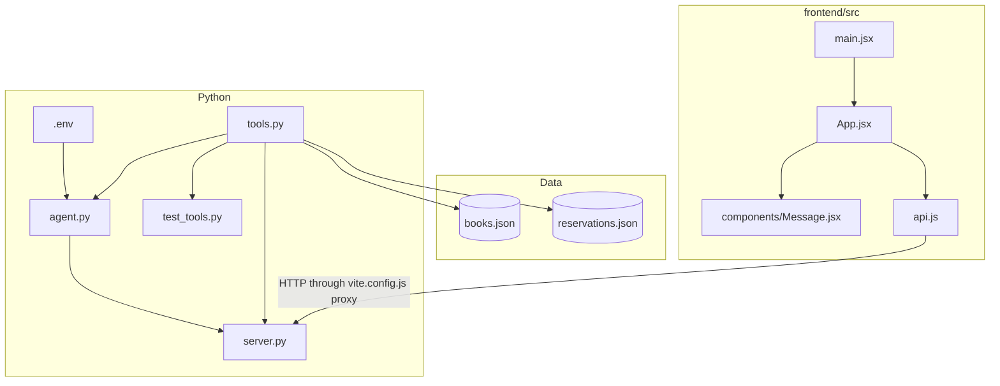

---

## 4. The data

### `books.json`

A list of books. Each book has:

| Field | Type | Example | Meaning |
|---|---|---|---|
| `id` | number | `101` | Unique book ID |
| `title` | text | `"Python Crash Course"` | Book title |
| `author` | text | `"Eric Matthes"` | Author |
| `category` | text | `"Programming"` | Subject area |
| `available_copies` | number | `3` | Copies that can still be reserved |

Sample catalogue:

| ID | Title | Category | Copies |
|---|---|---|---|
| 101 | Python Crash Course | Programming | 3 |
| 102 | Automate the Boring Stuff with Python | Programming | 2 |
| 103 | Clean Code | Software Engineering | 1 |
| 104 | Artificial Intelligence: A Modern Approach | Artificial Intelligence | 2 |
| 105 | Deep Learning | Artificial Intelligence | **0** (for the "no copies" test) |
| 106 | Hands-On Machine Learning with Scikit-Learn and TensorFlow | Artificial Intelligence | 1 |
| 107 | The Pragmatic Programmer | Programming | 1 |

### `reservations.json`

Starts as `[]`. Each approved reservation adds an entry:

```json
{
  "reservation_id": "R-0001",
  "book_id": 101,
  "title": "Python Crash Course",
  "customer_name": "Ahmed",
  "reserved_at": "2026-11-05T06:07:23+00:00"
}
```

The time is stored in UTC. The ID counts up: `R-0001`, `R-0002`, and so on.

### How they relate

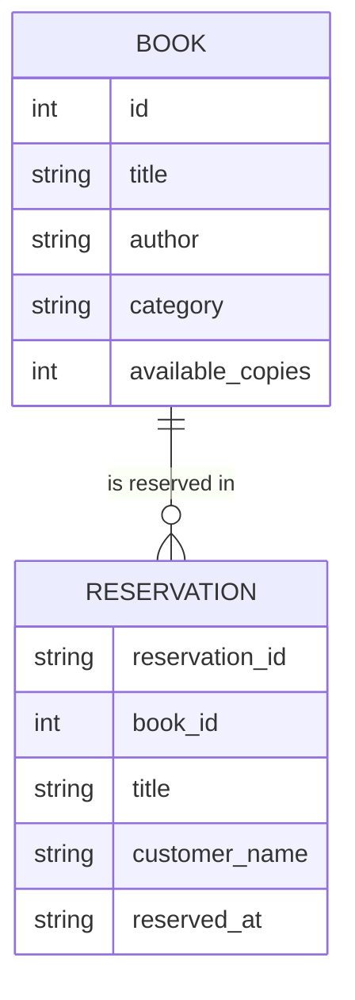

One book can have many reservations. Each reservation points to one book through `book_id`. Every approved reservation lowers that book's `available_copies` by 1, and both files are saved together.

---

## 5. The two tools

The model is offered exactly two tools. Their descriptions live in `TOOLS` in `agent.py`. That text is all the model ever sees; it never reads the Python code.

### Tool 1: `search_books(query)`

Finds books that share words with the query.

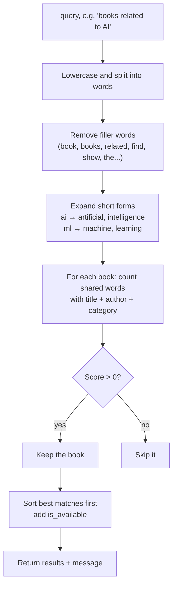

Example result:

```json
{
  "query": "Python",
  "results": [
    {"id": 101, "title": "Python Crash Course", "author": "Eric Matthes",
     "category": "Programming", "available_copies": 3, "is_available": true}
  ],
  "message": "Matching books found."
}
```

### Tool 2: `reserve_book(book_id, customer_name)`

Reserves one copy, but only after a human approves. The checking part is its own function, `check_reservation()`, so the web server can run the checks *before* showing buttons.

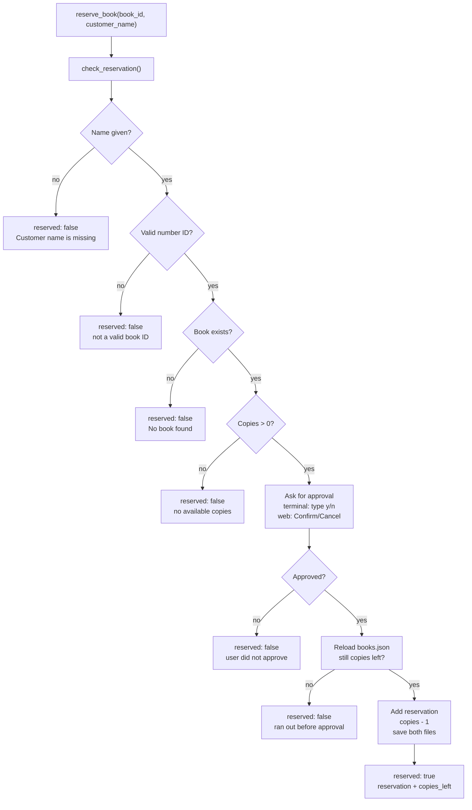

Notice that nothing is ever saved on a "no" path, and that availability is checked twice: once before asking, and again after approval, in case time passed while waiting.

---

## 6. The agent loop

This is the heart of the project. Both `agent.py` and `server.py` follow it.

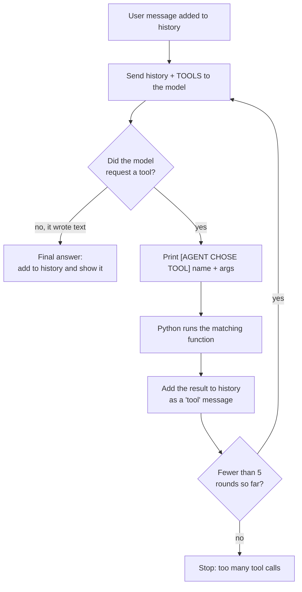

The model may need more than one round. For "Reserve Python Crash Course for Ahmed", it doesn't know the ID, so it searches first:

| Round | The model says | Python does |
|---|---|---|
| 1 | Call `search_books("Python Crash Course")` | Returns ID 101, 3 copies |
| 2 | Call `reserve_book(101, "Ahmed")` | Asks approval, saves, returns `R-0001` |
| 3 | "Done! Reserved for Ahmed, ID R-0001." | Shows the answer |

### What the model actually receives

The model has no memory between calls. Each time, it gets the whole conversation (the **history**). Every tool request has an ID, and its result must carry the same ID so the model can match them:

```json
[
  {"role": "system", "content": "You are a friendly library assistant. Rules: ..."},
  {"role": "user", "content": "Reserve Python Crash Course for Ahmed."},
  {"role": "assistant", "content": "", "tool_calls": [
    {"id": "call_1", "type": "function",
     "function": {"name": "search_books", "arguments": "{\"query\": \"Python Crash Course\"}"}}
  ]},
  {"role": "tool", "tool_call_id": "call_1", "content": "{\"results\": [{\"id\": 101, ...}]}"},
  {"role": "assistant", "content": "", "tool_calls": [
    {"id": "call_2", "type": "function",
     "function": {"name": "reserve_book", "arguments": "{\"book_id\": 101, \"customer_name\": \"Ahmed\"}"}}
  ]},
  {"role": "tool", "tool_call_id": "call_2", "content": "{\"reserved\": true, ...}"},
  {"role": "assistant", "content": "Done! Python Crash Course is reserved for Ahmed (R-0001)."}
]
```

| Role | Who writes it | Purpose |
|---|---|---|
| `system` | The program (`SYSTEM_PROMPT`) | Rules the model must follow |
| `user` | You | Your messages |
| `assistant` | The model | Tool requests or final answers |
| `tool` | Python | Tool results, linked by `tool_call_id` |

### The system prompt rules

1. Use `search_books` to find books or check availability, and only mention books the tool returns.
2. To reserve, you need the ID and the customer's name. Search first if you only have the title; ask the user if the name is missing.
3. Only say a reservation was made if `reserve_book` returns `reserved=true`.
4. Keep answers short and clear.

---

## 7. The terminal version

`python agent.py` runs a simple loop: read a line, run the agent loop, print the answer.

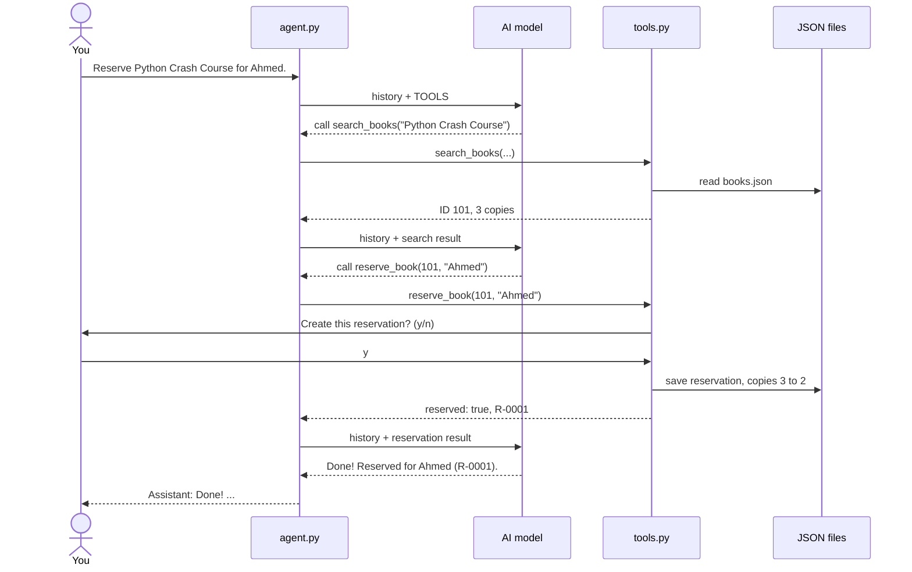

The terminal shows each decision:

```
[AGENT CHOSE TOOL] search_books  args={"query": "Python Crash Course"}
[TOOL RESULT] {"query": "Python Crash Course", "results": [...]}

[AGENT CHOSE TOOL] reserve_book  args={"book_id": 101, "customer_name": "Ahmed"}

--- RESERVATION APPROVAL REQUIRED ---
Book    : Python Crash Course (ID 101)
Customer: Ahmed
Create this reservation? (y/n): y
```

---

## 8. The web version

### Why there is a server in the middle

A web page cannot run Python or safely hold an API key. So the browser talks to `server.py`, and `server.py` talks to the model and the tools. The API key stays on your computer, inside Python.

### Ports and the proxy

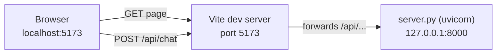

The browser only talks to port 5173. Vite forwards anything starting with `/api` to Python on port 8000 (see `vite.config.js`). The page and the API therefore look like one site, so no extra browser security setup (CORS) is needed.

### A normal question

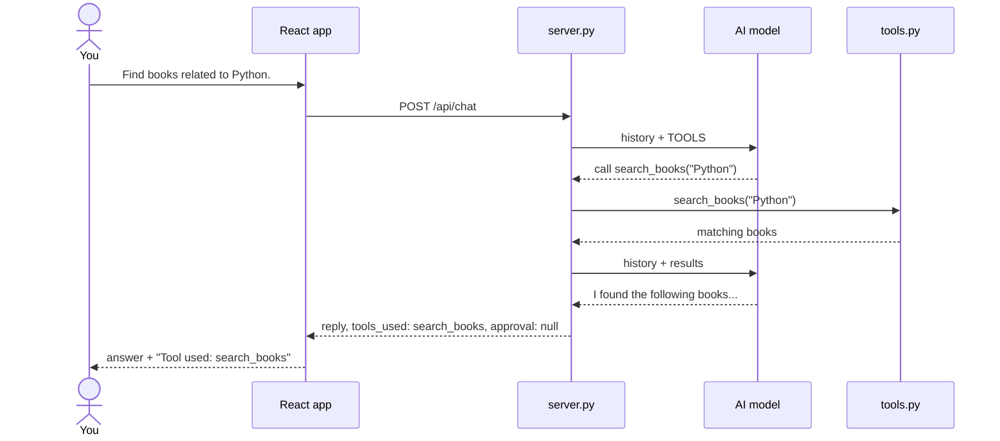

### Sessions: one conversation per tab

When the page opens, `App.jsx` creates a random **session ID** and sends it with every request. `server.py` keeps a dictionary in memory:

```
sessions = {
  "3f2a...": { "history": [...messages...], "pending": None or the waiting reservation },
  "9b7c...": { ... another tab ... }
}
```

Refreshing the page creates a new session, which is a new chat. Restarting `server.py` clears all sessions, but the JSON files keep every saved reservation.

---

## 9. Reservations and human approval

In the terminal, approval was a blocking `input()`. A web page can't type into a Python terminal, so the web version **pauses** the agent loop and resumes it when you click.

### The full web reservation flow

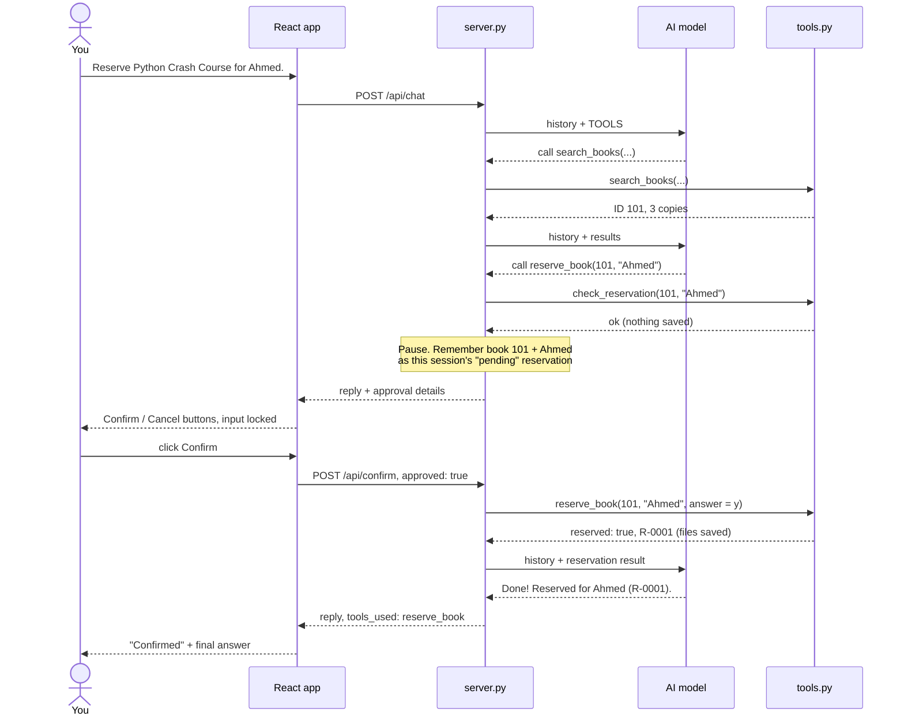

### The states of a reservation

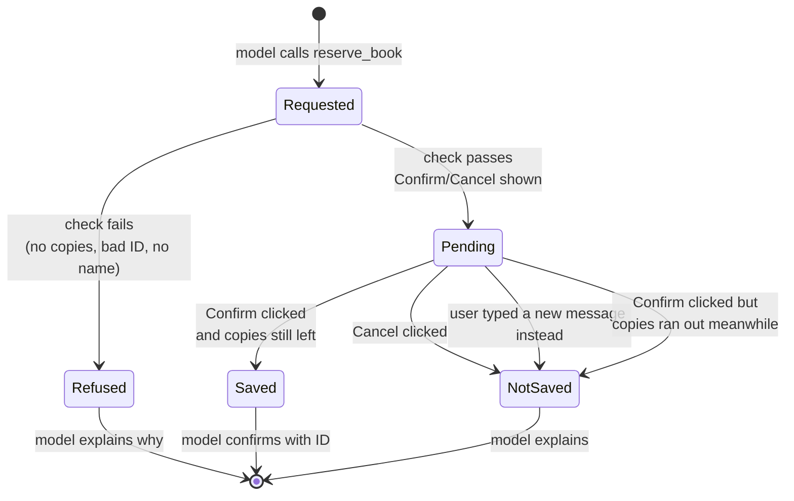

### Why it is built this way

- **The browser only sends yes or no.** The book and name are stored on the server when it pauses, so nobody can change *what* gets reserved by editing the request.
- **Buttons only appear for possible reservations.** `check_reservation()` runs first, so you never see Confirm for a book with no copies.
- **Same function in both versions.** The web server calls the same `reserve_book()` as the terminal; it just passes the button's answer instead of keyboard input.
- **Typing while a reservation waits.** The input box is disabled. If a message arrives anyway, the server records the reservation as "not approved" so the history stays valid.

---

## 10. The API reference

All endpoints are in `server.py`. While it runs, FastAPI also shows interactive docs at http://127.0.0.1:8000/docs.

### `GET /api/health`

Checks the server is running.

```json
{"status": "ok", "model": "openrouter/free"}
```

### `POST /api/chat`

Sends a message.

Request:
```json
{"session_id": "3f2a...", "message": "Reserve Python Crash Course for Ahmed."}
```

Response:
```json
{
  "reply": "'Python Crash Course' is available. Please confirm the reservation for Ahmed.",
  "tools_used": ["search_books", "reserve_book"],
  "approval": {"book_id": 101, "title": "Python Crash Course",
               "customer_name": "Ahmed", "available_copies": 3}
}
```

`approval` is `null` unless a reservation is waiting for Confirm/Cancel.

### `POST /api/confirm`

Answers a waiting reservation.

Request:
```json
{"session_id": "3f2a...", "approved": true}
```

Response: same shape as `/api/chat`, with the model's final message.

### Status codes

| Code | When | Message shown in the chat |
|---|---|---|
| 200 | Success | The reply |
| 400 | Empty message | Type a message first. |
| 409 | Confirm clicked with nothing waiting (e.g. server restarted) | There is no reservation waiting for approval... |
| 429 | Model rate limit | The AI model is busy (rate limit)... |
| 502 | Other AI service failure | The AI service failed: ... |

---

## 11. The React frontend

### Component tree

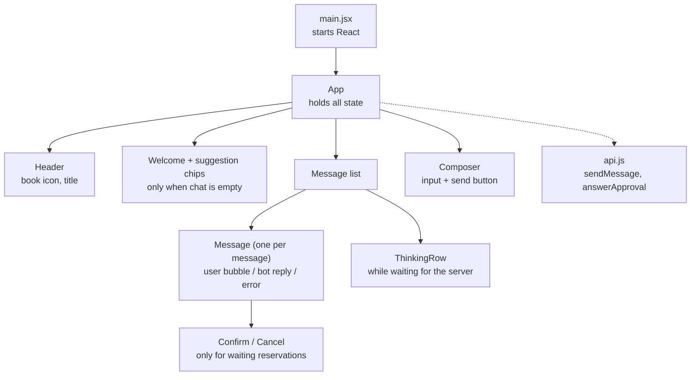

### State inside `App.jsx`

| State | Holds | Changes when |
|---|---|---|
| `sessionId` | Random ID for this tab | Never (until refresh) |
| `messages` | Every message shown on screen | You send, the server replies, or you click Confirm/Cancel |
| `input` | Text in the input box | You type |
| `loading` | Waiting for the server? | A request starts or ends |

`waitingForApproval` isn't stored separately. It's worked out from `messages`: true when some message has `approval` details but no `approvalStatus` yet.

### One message object

```js
{
  id: "a1b2...",
  role: "assistant",            // "user" | "assistant" | "error"
  text: "'Python Crash Course' is available...",
  toolsUsed: ["search_books", "reserve_book"],
  approval: { book_id: 101, title: "...", customer_name: "Ahmed", available_copies: 3 },
  approvalStatus: "confirmed"   // missing until a button is clicked
}
```

### What happens when you click Confirm

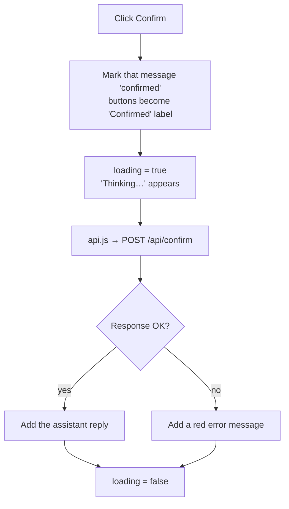

---

## 12. Choosing the AI model

`agent.py` reads `.env` when it starts:

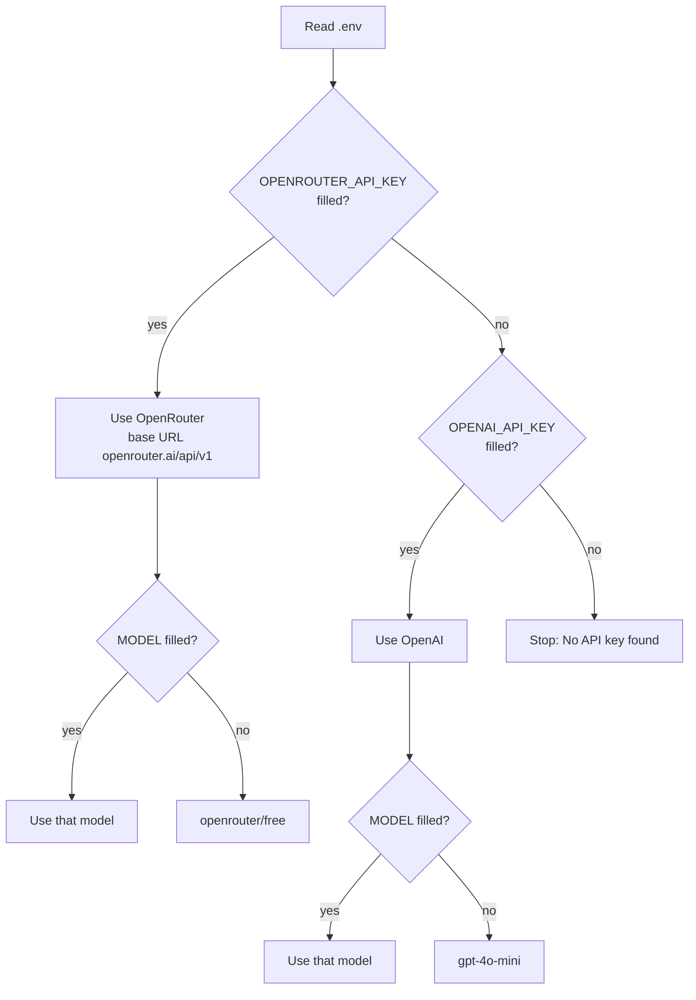

One `OpenAI` client works for both providers because OpenRouter accepts the same request format; only the address and key differ.

`openrouter/free` picks an available free model that supports tool calling. It's convenient for learning, but free models have low rate limits, may differ from call to call, and log prompts, so don't type real personal data. For consistent behaviour, set `MODEL=` to one specific model.

---

## 13. Error handling

| What goes wrong | Where it's caught | What you see | Is anything saved? |
|---|---|---|---|
| No API key | `agent.py` at start | `No API key found...` and the program stops | No |
| Model sends bad tool arguments | `run_tool()` | Model gets `{"error": ...}` and usually retries or explains | No |
| Model asks for an unknown tool | `run_tool()` | Model gets `Unknown tool` | No |
| Model loops on tools | 5-round limit | "Stopped after too many tool calls" | No |
| Rate limit during a chat | `server.py` / `agent.py` | Friendly rate-limit message; the half-finished turn is undone | No |
| AI fails during a chat | `server.py` | Error message; the turn is undone | No (reservations always pause first) |
| AI fails right after Confirm | `server.py` | Honest note: "Reserved ... (R-0001). The AI could not write a reply..." | Yes, and it says so |
| Python server not running | `api.js` | "Can't reach the library server..." | No |

---

## 14. Safety decisions

| Decision | Why |
|---|---|
| Approval happens in Python, not in the prompt | A model can ignore instructions; it cannot skip Python code |
| Availability checked before asking and again after approval | Never ask about impossible reservations; never over-reserve |
| Browser sends only yes/no | The book and name can't be changed from the browser |
| Model is told to claim success only if `reserved=true` | Prevents the model "pretending" a reservation happened |
| API key stays in `.env`, read by Python only | It never reaches the browser; `.gitignore` keeps it out of Git |
| Only listed functions can run (`AVAILABLE_FUNCTIONS`) | The model can't make Python run anything else |
| Tests use temporary copies of the data | Running tests never changes your real files |
| JavaScript packages pinned to patched versions | `npm audit` reports 0 vulnerabilities |

---

## 15. Testing

`test_tools.py` checks the tools without any API key or cost:

| Test | Checks that |
|---|---|
| `test_search_python` | "Python programming" finds books 101 and 102 |
| `test_search_ai_short_form` | "AI" finds the three AI books |
| `test_search_no_match` | "cooking" finds nothing |
| `test_reserve_approved` | Approving saves a reservation and lowers copies |
| `test_reserve_declined` | Declining saves nothing |
| `test_reserve_no_copies_never_asks` | A 0-copy book is refused without asking |
| `test_check_reservation_saves_nothing` | The check alone never changes files |
| `test_reserve_unknown_id` | An unknown ID is refused |

Run them with:

```bash
python -m unittest test_tools -v
```

To test the agent itself, use the five scenarios from the README and watch the `[AGENT CHOSE TOOL]` lines.

---

## 16. Glossary

| Term | Meaning |
|---|---|
| **Agent** | A program where an AI model decides which actions (tools) to take, in a loop, until the task is done |
| **Tool / function calling** | The model replies with "call this function with these arguments" instead of text |
| **Tool description** | The text in `TOOLS` that tells the model what each tool does and what arguments it takes |
| **System prompt** | Hidden rules sent at the start of every conversation |
| **History** | The full list of messages sent to the model on every call; the model's only memory |
| **`tool_call_id`** | Links a tool result to the request it answers |
| **Session** | One browser tab's conversation, kept by `server.py` |
| **Human in the loop** | A person must approve an action before it happens |
| **API / endpoint** | A URL a program can call, like `/api/chat` |
| **FastAPI / uvicorn** | Python library for building the API / the program that serves it |
| **React / Vite** | JavaScript library for building the page / the tool that runs it during development |
| **Proxy** | Vite forwarding `/api` requests from the page to Python |
| **OpenRouter** | A service offering many AI models (including free ones) through one OpenAI-style API |

---

## 17. Ideas for extending it

- **Cancel a reservation**: a third tool that removes an entry and adds the copy back (with approval).
- **List my reservations**: a read-only tool that filters `reservations.json` by name.
- **Real database**: replace the JSON files with SQLite so several people can use it safely at once.
- **Persistent chats**: save sessions to a file so restarting `server.py` doesn't clear them.
- **Streaming answers**: show the reply word by word as the model writes it.
- **New chat button**: clear `messages` and create a new session ID without refreshing.
- **Due dates**: add a return date to each reservation.
