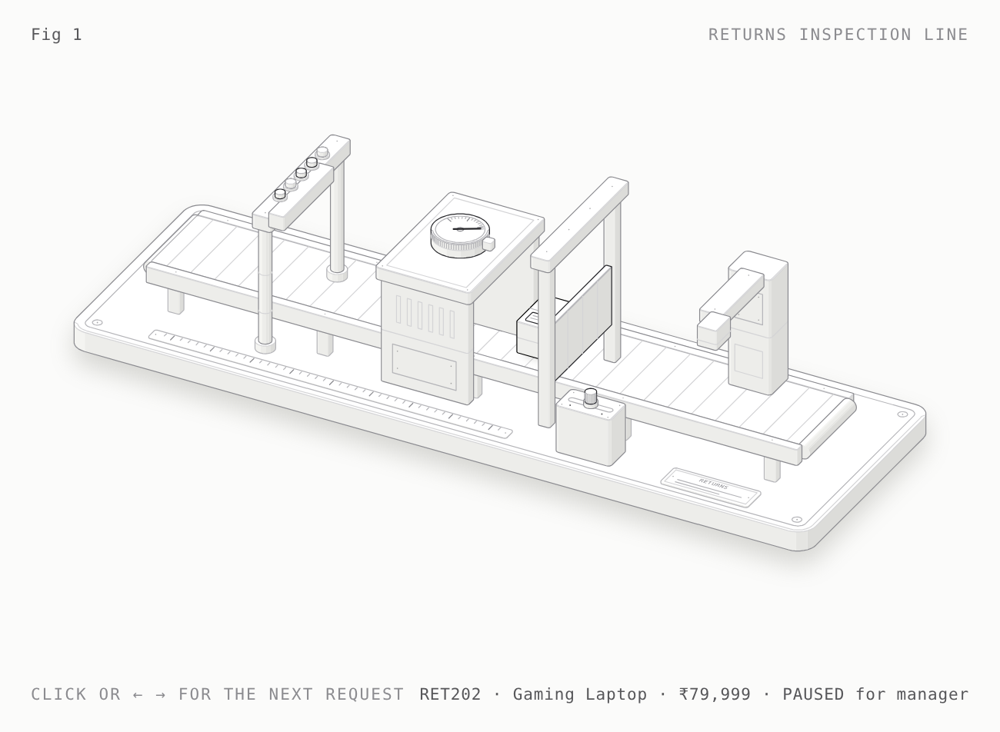
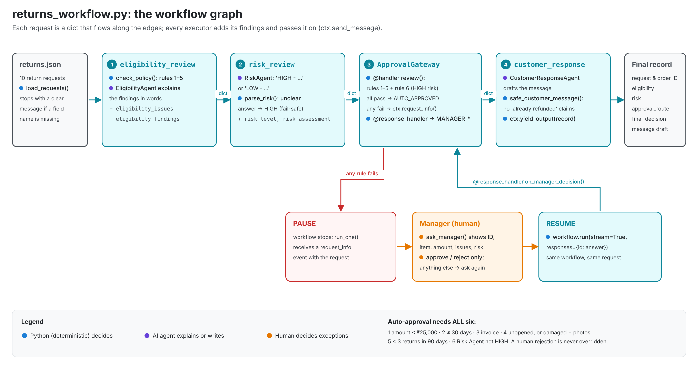

# E-commerce Returns & Refund Processing

A **graph-based multi-agent workflow** built with **Microsoft Agent Framework** and **Azure OpenAI (Azure AI Foundry)**. AI agents review each customer return request, Python rules decide whether it can be approved automatically, and anything high-value, risky or unusual **pauses for a human manager** to approve or reject.

> This is a simulation. No payments, messages or replacements are processed.



*Each parcel is one request. The arch's five lamps are policy rules 1–5, the hood's dial is the Risk Agent (rule 6), and the gate only lifts on its own when everything passes. Otherwise it waits for the manager's lever. Interactive version: [`docs/returns_line_figure.html`](docs/returns_line_figure.html).*

---

## Contents

1. [How the workflow works](#1-how-the-workflow-works)
2. [Business rules](#2-business-rules)
3. [Project structure](#3-project-structure)
4. [Setup](#4-setup)
5. [Running it](#5-running-it)
6. [Output format](#6-output-format)
7. [Testing (Task 7)](#7-testing-task-7)
8. [Capturing evidence and checking in (Task 8)](#8-capturing-evidence-and-checking-in-task-8)
9. [Troubleshooting](#9-troubleshooting)

---

## 1. How the workflow works

```
Return Request → Eligibility Agent → Risk Agent → Approval Gateway → Customer Response Agent → Final Output
```



The workflow is a **directed graph** (`WorkflowBuilder`). Each node is an **executor** with one job. The request travels along the edges as a Python `dict`, and each executor adds its findings before passing it on with `ctx.send_message()`.

| # | Executor | Job | Who decides |
|---|---|---|---|
| 1 | `eligibility_review` | `check_policy()` tests rules 1–5; the **Eligibility Agent** explains the findings in words | Python |
| 2 | `risk_review` | The **Risk Agent** returns `HIGH - …` or `LOW - …`; `parse_risk()` validates it, and an unclear answer counts as HIGH | AI, checked by Python |
| 3 | `ApprovalGateway` | All 6 conditions pass → `AUTO_APPROVED`. Otherwise it **pauses** with `ctx.request_info()`, and `@response_handler` resumes with the manager's decision. | Python + human |
| 4 | `customer_response` | The **Customer Response Agent** drafts the message; `safe_customer_message()` replaces any draft that claims a refund is already done or contradicts a rejection; `ctx.yield_output()` emits the final record | Python guards the AI |

**Human-in-the-loop:**

1. The gateway calls `ctx.request_info(...)` and the workflow **pauses**.
2. `run_one()` receives the `request_info` event.
3. `ask_manager()` shows the request ID, item, amount, eligibility issues and risk assessment, and accepts only `approve` or `reject`. Any other input asks again.
4. `workflow.run(stream=True, responses={request_id: answer})` **resumes** the same workflow. The full request context travels inside the pause request.

The decision is set in code before the Customer Response Agent runs, so **the AI cannot override a human rejection**.

---

## 2. Business rules

Automatic approval needs **all** of these. Any failure is escalated to human review.

| # | Rule | Code (`check_policy` / gateway) |
|---|---|---|
| 1 | Amount below ₹25,000 | `amount_inr < 25000` |
| 2 | Within 30 days of delivery | `days_since_delivery <= 30` |
| 3 | Invoice available | `invoice_available` is true |
| 4 | Unopened, or damaged with photos | `item_condition` is `UNOPENED`, or `DAMAGED` and `photo_evidence_available` |
| 5 | Fewer than 3 returns in 90 days | `previous_returns_90_days < 3` |
| 6 | Risk Agent did not flag HIGH | `risk_level != "HIGH"` |

Rules 1–5 are deterministic Python. Rule 6 uses the Risk Agent's answer, validated by Python.

---

## 3. Project structure

```
Returns_Refund_Workflow/
├── returns_workflow.py      # The complete application
├── returns.json             # The 10 supplied customer requests
├── requirements.txt         # Python dependencies
├── .env.example             # Configuration template (no real credentials)
├── .gitignore
├── README.md
├── docs/
│   ├── images/
│   │   ├── returns_line_figure.png   # Illustration of the workflow
│   │   └── workflow_graph.png        # Precise graph diagram
│   └── returns_line_figure.html      # Interactive illustration
└── screenshots/             # Task 8 evidence (you add these)
```

---

## 4. Setup

Run these in the PyCharm terminal from the project folder.

**1. Create and activate a virtual environment.**

```powershell
python -m venv .venv
.venv\Scripts\Activate.ps1
```

If PowerShell says *running scripts is disabled*, run `Set-ExecutionPolicy -Scope CurrentUser RemoteSigned` once, then activate again.

**2. Install the dependencies.**

```powershell
pip install -r requirements.txt
```

**3. Create `.env`** from the template and fill in all three values:

```powershell
Copy-Item .env.example .env
```

| Variable | Where to find it |
|---|---|
| `AZURE_OPENAI_API_KEY` | Foundry portal → your project → **API key** |
| `AZURE_OPENAI_BASE_URL` | The **Azure OpenAI endpoint** plus `/openai/v1/`, for example `https://<resource>.openai.azure.com/openai/v1/` |
| `AZURE_OPENAI_MODEL` | Foundry → **Deployments** → the **Name** column. This must be the deployment's name, not a model family such as `gpt-4.0`. |

**4. Check `returns.json`.** Every record must have these fields. The program stops with a clear message naming any that are missing:

`request_id`, `order_id`, `product`, `product_category`, `request_type`, `amount_inr`, `days_since_delivery`, `item_condition`, `return_reason`, `invoice_available`, `photo_evidence_available`, `previous_returns_90_days`

`item_condition` is compared in lowercase, so `UNOPENED` and `unopened` are the same. Only `UNOPENED`, and `DAMAGED` with photos, can pass rule 4.

---

## 5. Running it

```powershell
python returns_workflow.py
```

For each of the 10 requests you'll see the executors run in order:

```
############################################################
REQUEST RET201: Wireless Keyboard
  EligibilityAgent: 0 policy issue(s) found
  RiskAgent: LOW
  ApprovalGateway: all 6 conditions met -> automatic approval
  CustomerResponseAgent: drafting message
```

An escalated request pauses for you:

```
  ApprovalGateway: PAUSED - awaiting manager review

============================================================
MANAGER APPROVAL REQUIRED
Request ID : RET202  (order ORD-7302)
Item       : Gaming Laptop (Computers) - REFUND
Amount     : INR 79,999
Eligibility issues:
  - Amount INR 79,999 is not below INR 25,000
  - Item condition is 'used' (must be unopened, or damaged with photos)
Risk       : HIGH - High-value used laptop returned for performance expectations.
Escalated because: Amount INR 79,999 is not below INR 25,000; Item condition is 'used' (must be unopened, or damaged with photos); Risk Agent identified a HIGH risk
Type approve or reject: yes
  Invalid input 'yes'. Please type exactly approve or reject.
Type approve or reject: approve
  ApprovalGateway: RESUMED - manager chose approve
```

After all 10, a summary lists each request's route and decision.

---

## 6. Output format

Every request produces one structured record (Task 6):

```json
{
  "request_id": "RET202",
  "order_id": "ORD-7302",
  "product": "Gaming Laptop",
  "request_type": "REFUND",
  "requested_amount_inr": 79999,
  "eligibility_findings": {
    "policy_issues": [
      "Amount INR 79,999 is not below INR 25,000",
      "Item condition is 'used' (must be unopened, or damaged with photos)"
    ],
    "summary": "The request is within 30 days and has an invoice, but it exceeds the INR 25,000 limit and the laptop has been used."
  },
  "risk_assessment": { "level": "HIGH", "summary": "High-value used laptop returned for performance expectations." },
  "approval_route": "Human Review",
  "final_decision": "MANAGER_APPROVED",
  "customer_message_draft": "Dear Customer, your refund request for the Gaming Laptop (order ORD-7302) has been approved. ..."
}
```

`final_decision` is one of `AUTO_APPROVED`, `MANAGER_APPROVED` or `MANAGER_REJECTED`. `approval_route` is `Automatic` or `Human Review`.

---

## 7. Testing (Task 7)

**Expected routes for the supplied `returns.json`** (rules 1–5 are fixed; rule 6 depends on the Risk Agent):

| Request | Product | Rules 1–5 | Expected route |
|---|---|---|---|
| RET201 | Wireless Keyboard | All pass | Automatic, if risk is LOW |
| RET202 | Gaming Laptop | ₹79,999 ≥ ₹25,000; condition USED | Human review |
| RET203 | Ceramic Dinner Set | All pass (damaged, with photos) | Automatic, if risk is LOW |
| RET204 | Travel Suitcase | Damaged, no photos | Human review |
| RET205 | Yoga Mat | 44 days after delivery | Human review |
| RET206 | Desk Lamp | 4 returns in 90 days | Human review |
| RET207 | Coffee Grinder | No invoice | Human review |
| RET208 | Sketchbook Set | All pass | Automatic, if risk is LOW |
| RET209 | Smartwatch | Condition USED | Human review |
| RET210 | Floor Mirror | All pass (damaged, with photos) | Automatic, if risk is LOW |

| Requirement | How to demonstrate it |
|---|---|
| At least two automatic approvals | Run normally; look for `Automatic  AUTO_APPROVED` in the summary |
| Paused, then approved | At a `MANAGER APPROVAL REQUIRED` prompt, type `approve` |
| A different request paused, then rejected | At another prompt, type `reject` |
| Correct resumption | After each answer: `RESUMED - manager chose …`, then the customer message, then the final record |
| Invalid approval input | At a prompt, type `yes` (or anything else): it says *Invalid input* and asks again |
| Missing API configuration | Temporarily rename `.env` and run (commands below) |

```powershell
# Missing configuration test
Rename-Item .env .env.bak
python returns_workflow.py
# Expected: CONFIGURATION ERROR: missing AZURE_OPENAI_API_KEY, AZURE_OPENAI_BASE_URL, AZURE_OPENAI_MODEL.
Rename-Item .env.bak .env
```

---

## 8. Capturing evidence and checking in (Task 8)

**Save the whole console session,** including what you type, to a text file:

```powershell
Start-Transcript -Path screenshots\console_output.txt
python returns_workflow.py
Stop-Transcript
```

Also take screenshots of an automatic approval, a human approval, a human rejection, the invalid-input prompt and the configuration error, and put them in `screenshots/`.

**Check in.** `.env` must never be committed:

```powershell
# Each line must print the matching .gitignore rule
git check-ignore -v .env
# .env must not appear in this list
git status
git add returns_workflow.py returns.json requirements.txt .env.example .gitignore README.md docs screenshots
git commit -m "Returns & refund processing: graph workflow with human-in-the-loop"
git push
```

---

## 9. Troubleshooting

| Error | Cause and fix |
|---|---|
| `CONFIGURATION ERROR: missing …` | `.env` is missing or a value is empty. Copy `.env.example` to `.env` and fill it in. |
| `DATA ERROR: record N … is missing: …` | A field name in `returns.json` differs from section 4. Rename the field in the JSON, or update `REQUIRED_FIELDS` and the matching key in `check_policy()`. |
| `AZURE OPENAI ERROR: … 404 … deployment … does not exist` | `AZURE_OPENAI_MODEL` isn't a deployment name on that resource. Copy it exactly from Foundry → Deployments → Name. |
| `401` / authentication error | The API key doesn't belong to the resource in `AZURE_OPENAI_BASE_URL`, or it was regenerated |
| `ModuleNotFoundError: agent_framework` | Activate `.venv`, then `pip install -r requirements.txt` |
| Every request is escalated | Check that `item_condition` values are `unopened` / `damaged` and that the booleans are `true` / `false` in the JSON, not strings |
